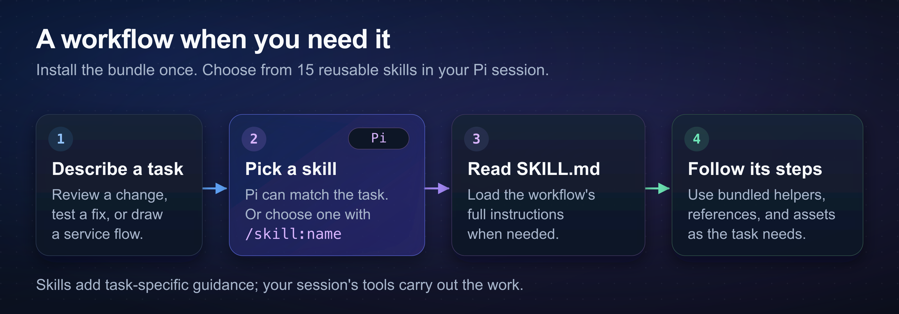

# pi-agent-skills

pi-agent-skills adds 16 task workflows to [Pi](https://pi.dev), the coding agent for your terminal. Each skill provides instructions and helper files for a task, such as code review or a diagram.



## Install and try it

This package requires Pi 1.0.0 or later and Node 24.21.0 or later. Install it from Git or a local checkout. It has no npm release.

Skills can tell Pi to run commands and change files. Read the [skill instructions](#skills) before you install this package.

```bash
pi install git:github.com/fitchmultz/pi-agent-skills
pi
```

Enter this command in Pi:

```text
/skill:deslop remove redundant code from this diff and preserve its behavior
```

## Choose a skill

Pi can choose a skill from your request. For example, ask it to review a PR for usability problems.

Enter `/skill:name` to choose a skill yourself:

```text
/skill:tdd add a failing test, then fix the bug
/skill:diagram-creation draw the request flow for this service
/skill:code-smells
/skill:code-smells packages/server/src/auth
/skill:bro
```

`bro` requires an explicit command.

Some skills require extra tools. The skill pages below list their requirements.

## Skills

| Skill | Use it for |
| --- | --- |
| [`ask-clarifying-questions`](skills/ask-clarifying-questions/SKILL.md) | Settle a decision that could change what gets built. |
| [`bro`](skills/bro/SKILL.md) | Restate the previous response in plain language. |
| [`clef`](skills/clef/SKILL.md) | Evaluate text or JSON with Cloudflare's decision models. |
| [`code-smells`](skills/code-smells/SKILL.md) | List code smells across the current project or a selected area, using full Clef through Cloudflare AI Gateway. |
| [`deslop`](skills/deslop/SKILL.md) | Remove AI-generated noise from a branch or PR. |
| [`diagram-creation`](skills/diagram-creation/SKILL.md) | Create diagrams with editable SVG or D2 source. |
| [`dogfood`](skills/dogfood/SKILL.md) | Test browser flows and capture evidence of UI problems. |
| [`handoff`](skills/handoff/SKILL.md) | Write instructions for the next session or a delegated task. |
| [`pi-extension-development`](skills/pi-extension-development/SKILL.md) | Build, debug, review, or package Pi extensions. |
| [`propose-then-ship-pi`](skills/propose-then-ship-pi/SKILL.md) | Research improvements, get your direction, then deliver a verified PR. |
| [`ssh-unix-ops`](skills/ssh-unix-ops/SKILL.md) | Work on Linux, macOS, or WSL2 hosts over SSH. |
| [`tdd`](skills/tdd/SKILL.md) | Write a test that fails, make it pass, then refactor. |
| [`test-audit`](skills/test-audit/SKILL.md) | Find brittle or redundant tests and check the value of new tests. |
| [`thermo-nuclear-code-quality-review`](skills/thermo-nuclear-code-quality-review/SKILL.md) | Review a branch or PR for maintainability problems. |
| [`ux-review`](skills/ux-review/SKILL.md) | Review user-facing changes for usability and complete workflows. |
| [`verification-before-completion`](skills/verification-before-completion/SKILL.md) | Check the evidence before you claim that work is complete. |

## Compatibility

The skills support official Pi and [`fitchmultz/pi`](https://github.com/fitchmultz/pi). Their extension APIs can differ even when their version numbers match. Read the [version hazards reference](skills/pi-extension-development/references/current-version-hazards.md) before you build an extension.

## Development and evaluations

Read the [maintenance guide](docs/maintaining-skills.md) to change a skill or run local checks. Normal tests need no model credentials.

Live model evaluations can incur provider charges. Read the [evaluation guide](docs/evaluations.md) before you run them. The [0.7.0 results](docs/evaluation-results.md) document a past comparison and its limits.

The [changelog](CHANGELOG.md) records changes to this package.

## License

[MIT](LICENSE) © Mitch Fultz.
